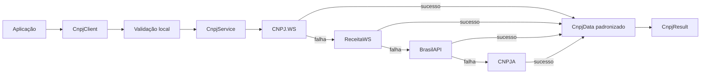

# GetCNPJ para PHP: uma biblioteca resiliente para consultar empresas brasileiras

Consultar um CNPJ parece uma tarefa simples: enviar uma requisição HTTP, interpretar um JSON e devolver os dados da empresa. Na prática, cada provedor possui seu próprio contrato, nomenclatura, estrutura de endereço, formato de datas, limites de requisição e comportamento em caso de erro.

Foi para resolver essa complexidade que criei o **GetCNPJ**. O projeto nasceu como uma biblioteca para .NET e agora também está disponível para o ecossistema PHP, com suporte a **PHP puro, Laravel e CodeIgniter 4**.

O objetivo é oferecer uma única API para consultar dados públicos de empresas brasileiras, independentemente do provedor que respondeu à requisição.

O projeto é open source, distribuído sob licença MIT:

- [Código-fonte no GitHub](https://github.com/azumamagus/GetCNPJ-php)
- [Pacote no Packagist](https://packagist.org/packages/azumamagus/get-cnpj)
- [.NET no NuGet](https://www.nuget.org/packages/GetCNPJ)

## O problema que a biblioteca resolve

Uma aplicação que depende diretamente de uma única API externa também herda os problemas dessa API. Se o serviço ficar indisponível, alterar seu contrato ou atingir o limite de requisições, a consulta deixa de funcionar.

Além disso, integrar vários serviços diretamente ao código da aplicação cria outro problema: cada resposta precisa ser tratada de uma maneira diferente. Um provedor pode chamar um campo de `razao_social`, outro de `nome_empresarial`, enquanto um terceiro pode aninhar o mesmo dado em outro objeto.

O GetCNPJ adiciona uma camada de abstração entre a aplicação e esses serviços externos. Atualmente, a biblioteca integra quatro provedores:

1. **CNPJ.WS**
2. **ReceitaWS**
3. **BrasilAPI**
4. **CNPJA**

A aplicação recebe sempre o mesmo modelo de resposta. A origem dos dados pode mudar sem obrigar controllers, services ou regras de negócio a conhecerem o formato particular de cada API.

## Instalação

O pacote requer PHP 8.1 ou superior e pode ser instalado pelo Composer:

```bash
composer require azumamagus/get-cnpj
```

O Guzzle é incluído como implementação HTTP padrão, mas o núcleo trabalha com `Psr\Http\Client\ClientInterface`. Portanto, qualquer cliente compatível com PSR-18 pode ser injetado.

## Primeira consulta com PHP puro

O uso mais simples não depende de framework:

```php
<?php

require __DIR__ . '/vendor/autoload.php';

use GetCNPJ\CnpjClient;

$result = (new CnpjClient())->get('03.312.791/0001-83');

if (!$result->success) {
    echo $result->errorMessage . PHP_EOL;
    return;
}

$empresa = $result->data;

echo $empresa->razaoSocial . PHP_EOL;
echo $empresa->endereco?->getEnderecoCompleto() . PHP_EOL;
echo 'Provedor: ' . $empresa->provedor . PHP_EOL;
```

O CNPJ pode ser informado com ou sem máscara. Antes de acessar a rede, a biblioteca remove a formatação e valida os dois dígitos verificadores. Valores inválidos lançam `InvalidCnpjException` e não consomem requisições dos provedores.

## Como o fallback funciona

O `CnpjClient` monta a lista dos provedores habilitados e a entrega ao `CnpjService`. Os adapters implementam o contrato `CnpjProviderInterface` e são ordenados por prioridade.

O fluxo de uma consulta é:



Para cada provedor, o serviço:

1. aguarda o rate limiter, quando necessário;
2. realiza a requisição HTTP;
3. valida o status e o JSON recebido;
4. converte a resposta para o modelo comum `CnpjData`;
5. devolve o resultado imediatamente em caso de sucesso;
6. registra o erro e tenta o próximo provedor em caso de falha.

Uma indisponibilidade isolada não interrompe a operação. Os erros anteriores ficam disponíveis em `$result->errors`, o que permite registrar métricas e diagnosticar a saúde de cada integração.

```php
if (!$result->success) {
    foreach ($result->errors as $error) {
        echo "{$error->providerName}: {$error->errorMessage}" . PHP_EOL;
    }
}
```

Erros de rede, respostas HTTP não esperadas e JSON inválido são encapsulados como falhas do provedor. Já um CNPJ inválido interrompe o fluxo imediatamente, porque tentar os demais serviços não mudaria o resultado.

## Resposta padronizada e objetos tipados

Toda consulta retorna uma instância de `GetCNPJ\Models\CnpjResult`:

```php
$result->success;              // bool
$result->data;                 // ?CnpjData
$result->errorMessage;         // ?string
$result->errors;               // ProviderError[]
$result->getFailedProviders(); // string[]
```

Quando a consulta tem sucesso, `CnpjData` reúne os principais grupos de informação:

| Grupo | Dados disponíveis |
|---|---|
| Identificação | CNPJ, razão social e nome fantasia |
| Cadastro | abertura, situação, tipo e porte |
| Jurídico | natureza jurídica e capital social |
| Endereço | logradouro, número, bairro, município, UF e CEP |
| Atividades | CNAE principal e atividades secundárias |
| Pessoas | quadro societário |
| Contato | telefones e e-mail |
| Fiscal | inscrições estaduais e Simples Nacional |
| Origem | provedor e data da última atualização |

As datas são representadas por `DateTimeImmutable`. Os modelos implementam `JsonSerializable`, facilitando seu uso em APIs:

```php
echo json_encode(
    $result,
    JSON_PRETTY_PRINT | JSON_UNESCAPED_UNICODE | JSON_UNESCAPED_SLASHES,
);
```

Exemplo resumido da saída:

```json
{
  "success": true,
  "data": {
    "cnpj": "03.312.791/0001-83",
    "razaoSocial": "SOS SYSTEM TECNOLOGIA EM INFORMATICA LTDA",
    "situacao": "Ativa",
    "telefones": ["(14) 3206-2096"],
    "provedor": "CNPJWS"
  },
  "errorMessage": null,
  "errors": [],
  "failedProviders": []
}
```

## Consultando um provedor específico

Embora o fallback seja o comportamento recomendado, também é possível selecionar explicitamente um provedor. O enum `ProviderType` evita strings espalhadas pelo código:

```php
use GetCNPJ\CnpjClient;
use GetCNPJ\ProviderType;

$result = (new CnpjClient())->getFromProvider(
    '03312791000183',
    ProviderType::BrasilAPI,
);
```

Esse recurso é útil para diagnósticos, comparação de respostas ou cenários nos quais um campo específico só está disponível em determinado serviço. Atualmente, por exemplo, as inscrições estaduais são obtidas pelo CNPJ.WS quando presentes na resposta.

## Rate limiting com Sliding Window

APIs públicas normalmente impõem limites de consumo. Para reduzir bloqueios acidentais, o pacote inclui o `SlidingWindowRateLimiter`.

Por padrão, são permitidas três requisições por minuto **para cada provedor**. Os timestamps são mantidos separadamente, portanto uma chamada feita ao CNPJ.WS não consome a cota interna da BrasilAPI.

Quando o limite é alcançado, a execução aguarda até a requisição mais antiga sair da janela. O relógio e a função de espera podem ser substituídos, o que permite testar esse comportamento sem adicionar atrasos reais à suíte.

O controle padrão vive em memória durante a vida da instância de `CnpjClient`. Em aplicações distribuídas ou executadas em vários workers, ainda é recomendável usar cache, limitar o consumo na infraestrutura ou criar uma implementação de `RateLimiterInterface` com armazenamento compartilhado.

## Configuração avançada

Os provedores, o timeout e o limite de requisições podem ser configurados com `CnpjClientOptions`:

```php
use GetCNPJ\CnpjClient;
use GetCNPJ\CnpjClientOptions;

$options = new CnpjClientOptions(
    timeout: 15,
    maxRequestsPerMinute: 5,
    enableCnpjWs: true,
    enableReceitaWs: true,
    enableBrasilApi: true,
    enableCnpja: false,
);

$client = new CnpjClient(options: $options);
```

Também é possível injetar um cliente PSR-18 customizado para configurar proxy, observabilidade, instrumentação ou políticas HTTP próprias:

```php
use GetCNPJ\CnpjClient;
use GuzzleHttp\Client;

$httpClient = new Client([
    'timeout' => 15,
    'proxy' => 'http://proxy.exemplo:8080',
    'http_errors' => false,
]);

$client = new CnpjClient(httpClient: $httpClient);
```

Essa separação também torna os testes determinísticos: o cliente HTTP real pode ser substituído por um mock sem que a regra de fallback precise ser alterada.

## Integração com Laravel

O pacote declara seu Service Provider e sua Facade na seção `extra.laravel` do `composer.json`. Com o package discovery padrão, o Laravel realiza o registro automaticamente.

O `CnpjClient` é registrado como singleton no container. Assim, ele pode ser recebido diretamente por injeção de dependência:

```php
<?php

namespace App\Http\Controllers;

use GetCNPJ\CnpjClient;
use Illuminate\Http\JsonResponse;

final class EmpresaController extends Controller
{
    public function show(string $cnpj, CnpjClient $client): JsonResponse
    {
        return response()->json($client->get($cnpj));
    }
}
```

Também há uma Facade para usos mais diretos:

```php
use GetCNPJ\Integrations\Laravel\Facades\GetCNPJ;

$result = GetCNPJ::get('03.312.791/0001-83');
```

Para publicar o arquivo de configuração:

```bash
php artisan vendor:publish --tag=getcnpj-config
```

As opções podem então ser definidas no `.env`:

```dotenv
GETCNPJ_TIMEOUT=30
GETCNPJ_MAX_REQUESTS_PER_MINUTE=3
GETCNPJ_ENABLE_CNPJ_WS=true
GETCNPJ_ENABLE_RECEITA_WS=true
GETCNPJ_ENABLE_BRASIL_API=true
GETCNPJ_ENABLE_CNPJA=true
```

Se a aplicação já registrar uma implementação de `Psr\Http\Client\ClientInterface`, o Service Provider a reutiliza. Caso contrário, o pacote cria o cliente padrão.

## Integração com CodeIgniter 4

No CodeIgniter 4, a classe `GetCNPJ\Config\Services` participa do Service Discovery do framework. Isso permite resolver uma instância compartilhada com a função `service()`:

```php
<?php

namespace App\Controllers;

use CodeIgniter\HTTP\ResponseInterface;

final class Empresa extends BaseController
{
    public function show(string $cnpj): ResponseInterface
    {
        $result = service('getCnpj')->get($cnpj);

        return $this->response->setJSON($result);
    }
}
```

Para obter uma nova instância em vez do serviço compartilhado:

```php
$client = single_service('getCnpj');
```

As configurações seguem a convenção do `.env` do CodeIgniter:

```dotenv
getcnpj.timeout = 30
getcnpj.maxRequestsPerMinute = 3
getcnpj.enableCnpjWs = true
getcnpj.enableReceitaWs = true
getcnpj.enableBrasilApi = true
getcnpj.enableCnpja = true
```

As integrações com os frameworks são adaptadores ao redor do mesmo núcleo. Isso evita duplicação: validação, fallback, normalização e rate limiting funcionam da mesma maneira no PHP puro, no Laravel e no CodeIgniter 4.

## Decisões de arquitetura

Algumas escolhas importantes do projeto:

### Contratos pequenos

`CnpjProviderInterface`, `CnpjServiceInterface` e `RateLimiterInterface` separam responsabilidades. Novos provedores ou estratégias de limite podem ser adicionados sem modificar controllers e sem acoplar o domínio a um framework.

### Um adapter por provedor

Cada API externa possui uma classe responsável por conhecer seu endpoint e converter sua resposta para `CnpjData`. Diferenças de nomenclatura e estrutura ficam confinadas ao adapter.

### HTTP baseado em padrão

O uso da PSR-18 evita dependência rígida da implementação HTTP. Guzzle é a opção pronta para uso, mas não é uma exigência arquitetural do núcleo.

### Resultado explícito

Falhas esperadas dos provedores fazem parte de `CnpjResult`, em vez de desaparecerem ou quebrarem imediatamente todo o fallback. Exceções ficam reservadas para situações como entrada inválida ou erros internos tratados pelos adapters.

### Independência de framework

Laravel e CodeIgniter apenas cuidam da criação e do ciclo de vida do cliente. Toda a regra continua em classes PHP comuns, facilitando manutenção, testes e reutilização.

## Qualidade e testes automatizados

A suíte utiliza PHPUnit e respostas HTTP simuladas para testar:

- validação e normalização de CNPJ;
- mapeamento dos quatro provedores;
- ordem e comportamento do fallback;
- coleta de erros por provedor;
- rate limiting por Sliding Window;
- serialização dos modelos;
- container, singleton e Facade do Laravel;
- Service Discovery do CodeIgniter 4.

O GitHub Actions valida a instalação de produção e a sintaxe no PHP 8.1. A suíte completa, incluindo as integrações com frameworks, é executada no PHP 8.2, 8.3 e 8.4.

Novas tags seguem versionamento semântico e são detectadas automaticamente pelo webhook oficial do Packagist. Dessa forma, versões como `v1.1.0` aparecem no Composer sem manter credenciais de publicação em um workflow próprio.

## Uso responsável

O GetCNPJ consulta serviços públicos mantidos por terceiros. A camada de fallback melhora a disponibilidade, mas não transforma essas fontes em serviços oficiais nem elimina seus limites.

Ao usar a biblioteca em produção:

- respeite os termos de uso de cada provedor;
- implemente cache para consultas repetidas;
- monitore erros e latência por provedor;
- não trate os dados como substitutos de certidões oficiais;
- avalie as regras aplicáveis ao armazenamento e tratamento dos dados.

## Conclusão

O GetCNPJ para PHP nasceu da experiência adquirida com a versão .NET, mas foi desenhado para conversar naturalmente com o ecossistema PHP. O resultado é uma biblioteca pequena, tipada e independente de framework, com integrações convenientes onde elas realmente agregam valor.

Se você trabalha com PHP, Laravel ou CodeIgniter 4 e precisa consultar dados públicos de CNPJ, pode instalar agora:

```bash
composer require azumamagus/get-cnpj
```

O código está disponível no [GitHub](https://github.com/azumamagus/GetCNPJ-php). Issues, sugestões e pull requests são bem-vindos.

Se o projeto for útil no seu trabalho, considere deixar uma estrela no repositório e compartilhar com outros desenvolvedores PHP.
